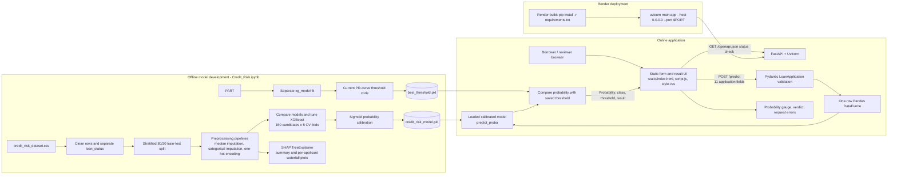

# Credit Risk Assessment with SHAP

A loan-default risk assessment project with a notebook-based training and analysis workflow, a saved XGBoost classifier, and a FastAPI web application. The app accepts borrower and loan details, estimates default probability, compares it with a saved decision threshold, and displays a high- or low-risk result.

> **Threshold limitation:** the notebook currently saves a threshold of `1.00`; evaluating that cutoff yielded zero positive predictions. The threshold calculation also uses `precision - recall` in its F1 expression, and the saved cutoff is calculated from a different, uncalibrated estimator than the calibrated model served by the API. Treat the current risk labels as a project demo until the threshold calculation is corrected and re-evaluated against the exact calibrated model used in production.

## System architecture



See [docs/system-architecture.md](docs/system-architecture.md) for component details, request flow, artifact relationships, deployment, and current limitations.

## Repository contents

| Path | Purpose |
| --- | --- |
| `Credit_Risk.ipynb` | Data cleaning, preprocessing, model comparison/tuning, evaluation, calibration, and SHAP analysis |
| `credit_risk_dataset.csv` | Source loan application data; target column is `loan_status` |
| `credit_risk_model.pkl` | Serialized calibrated classifier pipeline used by the API |
| `best_threshold.pkl` | Serialized probability cutoff used to assign the binary risk class |
| `main.py` | FastAPI startup, request schema, inference endpoint, and static file serving |
| `static/` | Browser form, styling, and JavaScript request/result handling |
| `requirements.txt` | Python runtime dependencies |
| `runtime.txt` | Python runtime version for deployment |
| `render.yaml` | Render web service build and start configuration |

## Model workflow and reported evaluation

The notebook starts with 32,581 source rows, removes duplicates and implausible records, and uses a stratified 80/20 train-test split. Numeric fields are median-imputed; categorical fields are imputed and one-hot encoded. `RandomizedSearchCV` evaluates 150 XGBoost configurations over 5 stratified folds (750 fits), optimizing average precision.

The notebook reports **92% accuracy, 81% precision, 81% recall, and 81% F1** for the tuned XGBoost estimator using its default class cutoff on a 6,305-row holdout set, rounded to two decimal places. These results are separate from `best_threshold.pkl` and do not validate that saved cutoff. The notebook also generates SHAP global summary and individual waterfall plots for model interpretation. SHAP explanations are produced during analysis and are not returned by the live API.

## Run locally

Use Python 3.11 (the deployment runtime is recorded in `runtime.txt`). From the repository root:

```powershell
py -3.11 -m venv .venv
.\.venv\Scripts\Activate.ps1
python -m pip install -r requirements.txt
uvicorn main:app --reload
```

Open `http://127.0.0.1:8000` for the UI or `http://127.0.0.1:8000/docs` for the FastAPI interactive API documentation. The model and threshold pickle files must be present beside `main.py` when the service starts.

## Prediction API

`POST /predict` accepts the following fields:

```json
{
  "person_age": 30,
  "person_income": 600000,
  "person_home_ownership": "RENT",
  "person_emp_length": 5,
  "loan_intent": "PERSONAL",
  "loan_grade": "B",
  "loan_amnt": 100000,
  "loan_int_rate": 11.5,
  "loan_percent_income": 0.17,
  "cb_person_default_on_file": "N",
  "cb_person_cred_hist_length": 6
}
```

The endpoint returns `default_probability`, `default_prediction` (0 or 1), `threshold`, and `Result` (`Low Risk` or `High Risk`). Pydantic validates field types and required fields. The UI calculates `loan_percent_income` from loan amount and income when those inputs change.

## Deployment

`render.yaml` defines a Render web service. Render installs dependencies from `requirements.txt`, then starts `uvicorn main:app --host 0.0.0.0 --port $PORT`. FastAPI serves the static frontend and prediction endpoint from the same service.

## Observability and limitations

- On page load, the browser checks whether `/openapi.json` responds successfully and displays a service-ready or service-unreachable status.
- Failed prediction requests are surfaced in the UI. The repository does not currently configure structured server logs, metrics, tracing, or an external monitoring service.
- The current threshold artifact has the issue described above; correct and re-evaluate threshold selection before using risk labels for decisions.
- The model returns an estimate for demonstration and should not be treated as a lending decision.

## Tech stack

Python, Pandas, Scikit-learn, XGBoost, SHAP, FastAPI, Pydantic, Joblib, Uvicorn, HTML, CSS, JavaScript, and Render.
