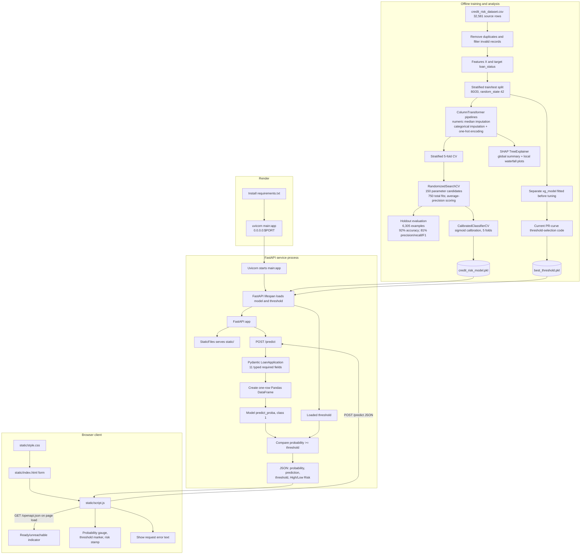

# System Architecture

## Overview

The project has an offline model-development path and an online inference path. The Jupyter notebook reads and prepares the loan dataset, trains and evaluates models, calibrates the selected XGBoost pipeline, and saves artifacts. A FastAPI application loads the serialized model and threshold at startup, serves the browser UI, and handles prediction requests.

## Training and artifact creation

1. `Credit_Risk.ipynb` loads `credit_risk_dataset.csv`; the source has 32,581 rows and the binary label is `loan_status`.
2. The notebook removes duplicate rows and applies plausibility filters, then splits features and labels using a stratified 80/20 split with `random_state=42`.
3. Preprocessing is embedded in Scikit-learn pipelines. Numeric columns use median imputation. Categorical columns use a constant missing-value fill and one-hot encoding with unknown categories ignored.
4. The notebook compares baseline models and runs `RandomizedSearchCV` for XGBoost with 150 candidate configurations and 5-fold stratified CV, scoring with average precision.
5. The notebook reports the tuned estimator's holdout metrics on 6,305 examples: 0.92 accuracy, 0.81 precision, 0.81 recall, and 0.81 F1 (rounded to two decimal places).
6. `CalibratedClassifierCV` with sigmoid calibration and 5-fold CV is fitted on the training split. The calibrated pipeline is serialized to `credit_risk_model.pkl`.
7. SHAP `TreeExplainer` is used in the notebook to visualize global feature effects and a local waterfall explanation. These are analysis outputs and are not part of the API response.

## Runtime request sequence

1. At application startup, FastAPI's lifespan handler loads `credit_risk_model.pkl` and `best_threshold.pkl` with Joblib into process memory.
2. FastAPI mounts `static/` at `/`, serving the form, CSS, and JavaScript from the same origin as the API.
3. The browser sends a `GET /openapi.json` request on page load. The response controls the simple ready/unreachable indicator. This is a browser-side availability check, not a dedicated health endpoint.
4. The user submits a form. JavaScript sends the 11 applicant and loan fields as JSON to `POST /predict`.
5. Pydantic validates the request schema. The endpoint creates a one-row Pandas DataFrame and calls the loaded model's `predict_proba` for the default class.
6. The endpoint compares the probability to the loaded threshold and returns the probability, binary prediction, threshold, and text result.
7. JavaScript renders the probability gauge and risk verdict; request failures are shown in the page.

## Deployment topology

Render builds the service by installing `requirements.txt` and starts Uvicorn with `uvicorn main:app --host 0.0.0.0 --port $PORT`. The API and static UI run in the same service. `runtime.txt` specifies Python 3.11.9.

## Artifact and threshold caveat

The notebook's threshold-selection cell currently calculates its F1-like score with `precisions - recalls` rather than `precisions + recalls`. Its saved threshold is displayed as `1.00`; evaluation at that threshold yields zero positive predictions (0 precision, recall, and F1). Also, the threshold is derived from `xg_model`, while the serialized API estimator is the sigmoid-calibrated `random_search.best_estimator_` pipeline. Therefore, the stored threshold is not demonstrated to be valid for the deployed probability outputs. Correct threshold selection, derive it from the exact calibrated model, and re-evaluate the deployed estimator before relying on risk labels.

## Observability boundary

The browser provides a one-time OpenAPI availability indicator and shows prediction request errors. The source does not configure structured logging, application metrics, tracing, alerting, or an external monitoring service. Render deployment configuration specifies build/start behavior but no monitoring integration.
